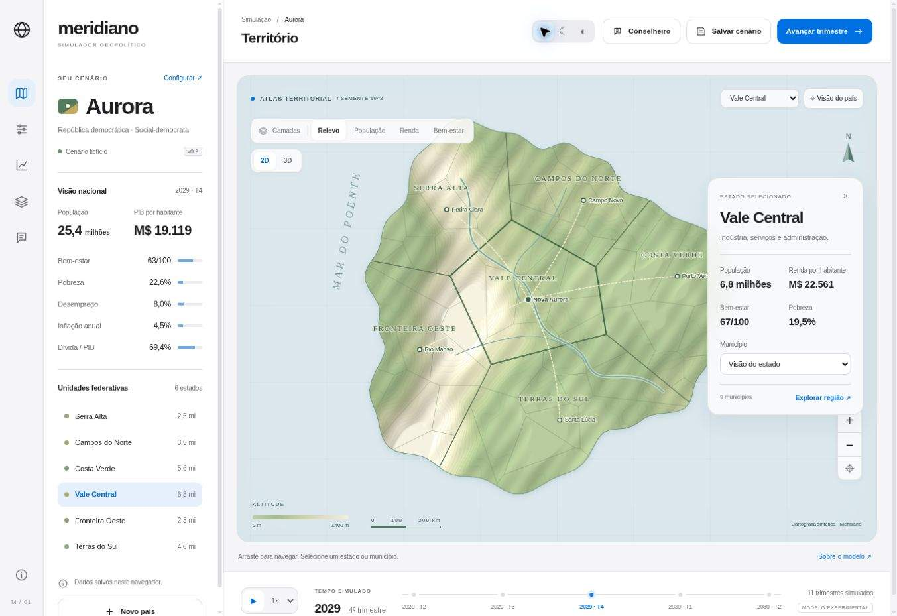
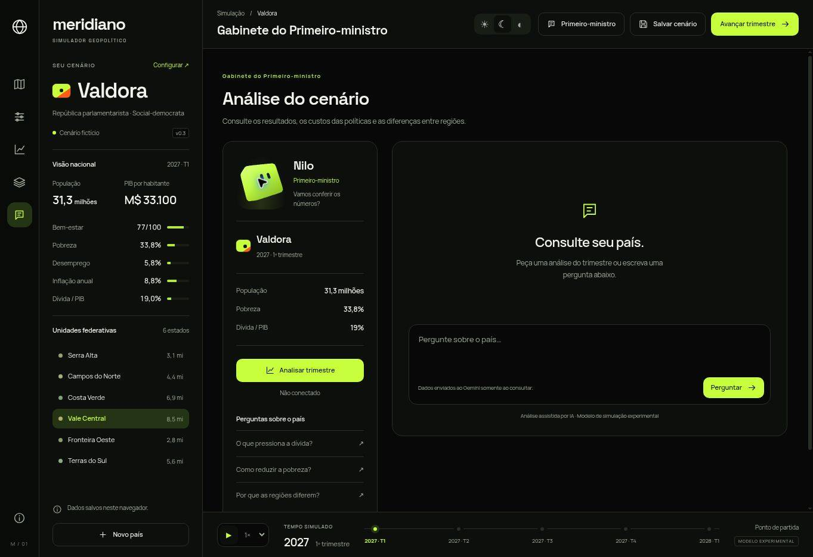

# Meridiano

Um laboratório para criar países fictícios, explorar seus territórios e experimentar políticas públicas.





## Versão 0.8 · investimentos regionais

- Compare necessidades dos estados e avalie saneamento, atenção básica, educação e mobilidade pelo mapa ou pela carteira em Políticas.
- Antes de contratar, consulte investimento, prazo estimado, moradores atendidos, manutenção e impacto no orçamento.
- Acompanhe planejamento, construção, entrega e operação; capacidade e relevo alteram o ritmo da obra.
- Obras são pagas por trimestre; manutenção e benefícios locais/nacionais entram depois da entrega. Boletim e balanço registram os marcos.
- Até três programas em implantação e um de cada tipo por estado; cancelamento sem cobrança antes do primeiro avanço.
- Carteira preservada ao salvar/retomar e incluída no contexto validado do Nilo. Funciona também em cenários com a geografia original.
- Regras e coeficientes: [Investimentos regionais](docs/INVESTMENTS.md).

## Versão 0.7 · território e demografia

- Novos países têm litoral, relevo, rios e divisas próprios, reproduzíveis pela semente. Escolha área e formato ou sorteie tudo.
- De 3 a 12 estados e 20 a 240 municípios conforme extensão, população inicial e distribuição territorial. Cada município tem habitantes urbanos e rurais, área e densidade próprias.
- Camada de densidade, manchas urbanas e escala em quilômetros; população e áreas fecham nos totais nacionais.
- Atlas MapLibre sob demanda com seleção, zoom e rótulos por aproximação; SVG e Three compartilham a mesma geometria. Sem tiles de países reais.
- Acontecimentos e contexto do Nilo usam os estados gerados. Cenários antigos mantêm sua geografia original; crie um novo país para experimentar o gerador.
- Regras e limites: [Território](docs/TERRITORY.md). Renda, pobreza e bem-estar municipais ainda seguem o estado; não há migração.

## Versão 0.6 · decisões e consequências

- O compositor do Nilo recolhe em um blob durante a consulta, com transição e reabertura a qualquer momento para liberar a área de leitura.

- Compare até quatro trimestres com os ajustes atuais e com as políticas do início do trimestre; veja custo, receita, pobreza, bem-estar e dívida antes de avançar.
- Desfaça ajustes e consulte os grupos afetados e o prazo de cada política.
- Confira o balanço do trimestre, as medidas aplicadas e a projeção com condições conhecidas.
- Responda a acontecimentos de abastecimento, serviços, transporte e investimento, com três opções e efeitos explícitos por um trimestre.
- Decisões pendentes pausam o tempo e continuam nos cenários salvos. O custo extraordinário é cobrado uma vez.
- Regras, limites e compatibilidade: [Ciclo de decisões](docs/DECISION-CYCLE.md).

## Versão 0.3

- Interface em 100dvh no desktop, com rolagem apenas nos painéis; temas claro/escuro/sistema.
- Cores do NX Creative Studio; fontes Manrope e Space Grotesk hospedadas localmente.
- Países aleatórios com prévia e confirmação; condições iniciais e políticas reproduzíveis por semente.
- Nilo, avatar criado no Avatar Lab, com expressões, piscadas e cargo ligado ao governo.
- Atlas procedural por semente, relevo sombreado e curvas de nível.
- Visão 3D opcional com Three.js/WebGL, carregamento sob demanda e fallback para SVG.
- Reprodução do tempo com play/pause e velocidades 1×, 2× e 4×.
- Conselheiro Gemini para análise de trimestre e perguntas, com chave protegida no servidor.
- Seis estados, municípios, capitais, rios e conexões esquemáticas.
- Seleção territorial por mapa, lista ou controles nativos acessíveis; zoom, arraste e centralização.
- Camadas de relevo, população, renda e bem-estar.
- Configuração de país, sistema político, orientação econômica e contexto externo.
- Renda básica, previdência, proteção trabalhista, tributação, saúde/educação e infraestrutura.
- Simulação trimestral de indicadores, orçamento, dívida e capacidade de execução; horizonte de 40 anos.
- Histórico gráfico, relatórios trimestrais, snapshots locais, comparação e exportação JSON.

## Executar

Recomenda-se Node.js 22 ou superior. Three.js é a dependência de visualização, e Fontsource fornece as duas fontes locais; Prettier é usado somente no desenvolvimento. A chave Gemini é opcional para o Conselheiro.

```sh
npm ci
npm run dev
```

Abra `http://localhost:4173`. O servidor local é apenas para desenvolvimento.

```sh
npm run check
npm test
npm run build
```

O build prepara os módulos locais do Three.js e copia os arquivos estáticos de `dist/` para `build/`. Para Vercel: preset **Other**, instalação `npm ci`, comando `npm run build`, saída `build`. O endpoint Node fica em `api/advisor.js`. Configure `GEMINI_API_KEY` nos ambientes desejados e faça novo deploy. Veja [ativação e limites do Conselheiro](docs/AI.md).

## Estrutura

| Arquivo | Responsabilidade |
| --- | --- |
| `dist/index.html` | Estrutura e controles da aplicação |
| `dist/premium.css` | Tokens de tema, interface e responsividade |
| `dist/style.css` | Base de compatibilidade da interface e cartografia |
| `dist/terrain3d.js` | Cena Three.js e gestão de recursos WebGL |
| `dist/advisor.js` | Consultas, cancelamento e apresentação de análises |
| `api/advisor.js` | Endpoint Node para Vercel |
| `server/advisor.js` | Validação e integração Gemini |
| `dist/app.js` | Interface, estado, persistência e renderização |
| `dist/model.js` | Equações e parâmetros da simulação |
| `dist/geography.js` | Gerador determinístico e divisões Voronoi |
| `tests/model.test.js` | Invariantes, efeitos fiscais e geografia |
| `docs/MODEL.md` | Premissas e limites |
| `DESIGN.md` | Identidade visual e tokens |
| `UX-CONTRACT.md` | Comportamentos e acessibilidade |

## Natureza do modelo

**Modelo experimental, sem calibração empírica. Não produz previsões econômicas.** Todos os dados são sintéticos e os coeficientes são hipóteses explícitas. As relações não devem ser interpretadas como evidências sobre países ou ideologias reais.

Nesta versão, governo e orientação econômica são metadados independentes. Os controles de políticas e o contexto externo determinam as trajetórias. Municípios compartilham índices estaduais e recebem parcelas iguais da população do estado. As coordenadas dos centros estaduais são fixas; a semente varia litoral, relevo e distribuição municipal. Rios e estradas são esquemáticos.

Dados ficam neste navegador, sem conta ou sincronização. São mantidos até 20 snapshots; um novo salvamento substitui o mais antigo quando o limite é atingido. Exporte cópias para conservar o trabalho. A importação JSON ainda não foi implementada.

## Limites da versão 0.3

A consulta real ao Gemini depende da chave e das cotas da sua conta. O controle de consultas em memória é por instância, não distribuído; recomenda-se acesso privado/baixo volume até implementar proteção persistente ou regras no firewall da hospedagem.

O ambiente de testes tem WebGL desabilitado: fallback 2D e geometria foram validados, mas renderização GPU e desempenho ainda precisam ser testados em hardware compatível. O mapa SVG continua disponível sem WebGL.

## Próximas etapas

1. Validar a experiência e a leitura do mapa com usuários.
2. Evoluir a geografia: bacias hidrográficas, conexões e cidades condicionadas ao relevo.
3. Separar economia, demografia e serviços por região e agregar resultados nacionais.
4. Adicionar parâmetros editáveis, faixas de incerteza e comparação com mesmas condições iniciais.
5. Modelar instituições, eleições, relações externas e comércio entre países.
6. Calibrar cenários com fontes e metodologia documentadas antes de qualquer pretensão preditiva.

O nome Meridiano é provisório. Sem licença de distribuição definida nesta etapa.

## Avatar e cargos

Os cargos são papéis fictícios de apoio. Veja [origem dos assets e fontes](THIRD_PARTY.md). A definição portátil e os SVGs originais do Lab estão em `docs/avatar-source/`; `python3 scripts/prepare-avatar.py` recompõe as adaptações visuais locais. A aplicação não importa o runtime AGPL do Lab.


### v0.4 · mesa de governo

Ilha de eventos por trimestre, compositor com contexto e Ctrl/Cmd+Enter, relógio da consulta, boletim animado, pontos do gráfico exploráveis por teclado e demonstrativo do orçamento. O modo Atlas detalha cidades e vias fictícias. Ícones Reicon locais; referências e adaptações em [THIRD_PARTY.md](THIRD_PARTY.md).

A API usa o Flash-Lite atual por padrão e diferencia falhas de chave, quota, acesso e modelo. Se houver `GEMINI_MODEL` antigo na Vercel, prefira `gemini-3.5-flash-lite` e faça redeploy. Configurar uma chave não garante que o projeto tenha quota ou permissão; veja [diagnóstico](docs/AI.md).


### v0.5 · conversa com Nilo

O campo de mensagem fica separado da rolagem da resposta. O texto aparece progressivamente, com opção de mostrar tudo; movimento reduzido mostra a resposta de imediato. A apresentação acontece depois do JSON completo, sem mudança no transporte da API.

No desktop a partir de 1280 px, Nilo também ocupa uma coluna própria com olhar, cumprimento, giro e reações à consulta. A versão pequena continua no gabinete. Abaixo dessa largura, a conversa tem prioridade e o personagem maior fica oculto. As poses compartilham o mesmo carregamento local e recebem IDs SVG distintos por instância.


### v0.9 · gabinete com ferramentas

Nilo coordena Fazenda, Saúde e Infraestrutura. As áreas investigam estados, consultam orçamento, comparam programas e preparam propostas com dados do motor. Cards permitem abrir o estado no mapa e revisar uma contratação; a confirmação continua com o jogador. Atalhos de dados funcionam sem IA. A conversa usa a chave já configurada. Regras em [CABINET.md](docs/CABINET.md) e integração em [AI.md](docs/AI.md).
