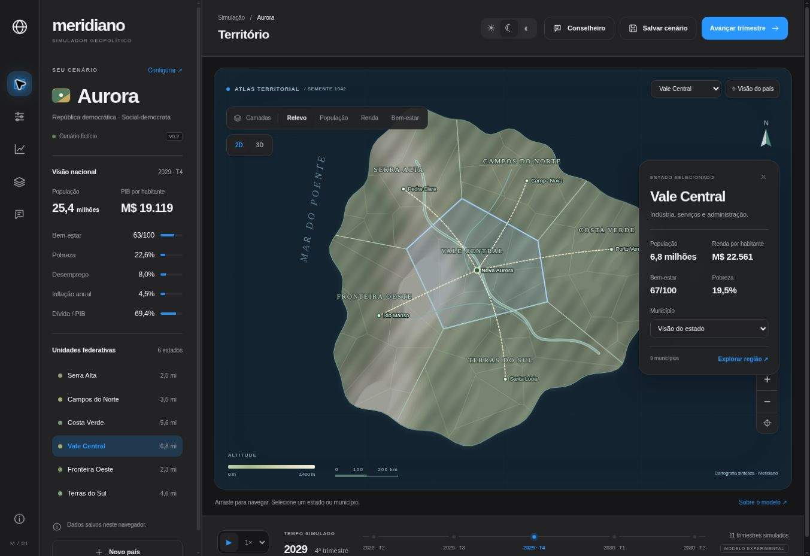

# Meridiano

Um laboratório para criar países fictícios, explorar seus territórios e experimentar políticas públicas.




## Versão 0.2

- Interface com temas claro, escuro e do sistema; preferência salva no navegador.
- Atlas procedural por semente, relevo sombreado e curvas de nível.
- Visão 3D opcional com Three.js/WebGL, carregamento sob demanda e fallback para SVG.
- Reprodução do tempo com play/pause e velocidades 1×, 2× e 4×.
- Conselheiro Gemini para análise de trimestre e perguntas, com chave protegida no servidor.
- Seis estados, municípios, capitais, rios e conexões esquemáticas.
- Seleção territorial por mapa, lista ou controles nativos acessíveis; zoom, arraste e centralização.
- Camadas de relevo, população, renda e bem-estar.
- Configuração de país, sistema político, orientação econômica e contexto externo.
- Renda básica, previdência, proteção trabalhista, tributação, saúde/educação e infraestrutura.
- Simulação trimestral de indicadores, orçamento, dívida e capacidade de execução; horizonte de 40 anos.
- Histórico gráfico, relatórios trimestrais, snapshots locais, comparação e exportação JSON.

## Executar

Recomenda-se Node.js 22 ou superior. Three.js é a dependência de visualização; Prettier é usado somente no desenvolvimento. A chave Gemini é opcional para o Conselheiro.

```sh
npm ci
npm run dev
```

Abra `http://localhost:4173`. O servidor local é apenas para desenvolvimento.

```sh
npm run check
npm test
npm run build
```

O build prepara os módulos locais do Three.js e copia os arquivos estáticos de `dist/` para `build/`. Para Vercel: preset **Other**, instalação `npm ci`, comando `npm run build`, saída `build`. O endpoint Node fica em `api/advisor.js`. Configure `GEMINI_API_KEY` nos ambientes desejados e faça novo deploy. Veja [ativação e limites do Conselheiro](docs/AI.md).

## Estrutura

| Arquivo | Responsabilidade |
| --- | --- |
| `dist/index.html` | Estrutura e controles da aplicação |
| `dist/premium.css` | Tokens de tema, interface e responsividade |
| `dist/style.css` | Base de compatibilidade da interface e cartografia |
| `dist/terrain3d.js` | Cena Three.js e gestão de recursos WebGL |
| `dist/advisor.js` | Consultas, cancelamento e apresentação de análises |
| `api/advisor.js` | Endpoint Node para Vercel |
| `server/advisor.js` | Validação e integração Gemini |
| `dist/app.js` | Interface, estado, persistência e renderização |
| `dist/model.js` | Equações e parâmetros da simulação |
| `dist/geography.js` | Gerador determinístico e divisões Voronoi |
| `tests/model.test.js` | Invariantes, efeitos fiscais e geografia |
| `docs/MODEL.md` | Premissas e limites |
| `DESIGN.md` | Identidade visual e tokens |
| `UX-CONTRACT.md` | Comportamentos e acessibilidade |

## Natureza do modelo

**Modelo experimental, sem calibração empírica. Não produz previsões econômicas.** Todos os dados são sintéticos e os coeficientes são hipóteses explícitas. As relações não devem ser interpretadas como evidências sobre países ou ideologias reais.

Nesta versão, governo e orientação econômica são metadados independentes. Os controles de políticas e o contexto externo determinam as trajetórias. Municípios compartilham índices estaduais e recebem parcelas iguais da população do estado. As coordenadas dos centros estaduais são fixas; a semente varia litoral, relevo e distribuição municipal. Rios e estradas são esquemáticos.

Dados ficam neste navegador, sem conta ou sincronização. São mantidos até 20 snapshots; um novo salvamento substitui o mais antigo quando o limite é atingido. Exporte cópias para conservar o trabalho. A importação JSON ainda não foi implementada.

## Limites da versão 0.2

A consulta real ao Gemini depende da chave e das cotas da sua conta. O controle de consultas em memória é por instância, não distribuído; recomenda-se acesso privado/baixo volume até implementar proteção persistente ou regras no firewall da hospedagem.

O ambiente de testes tem WebGL desabilitado: fallback 2D e geometria foram validados, mas renderização GPU e desempenho ainda precisam ser testados em hardware compatível. O mapa SVG continua disponível sem WebGL.

## Próximas etapas

1. Validar a experiência e a leitura do mapa com usuários.
2. Evoluir a geografia: bacias hidrográficas, conexões e cidades condicionadas ao relevo.
3. Separar economia, demografia e serviços por região e agregar resultados nacionais.
4. Adicionar parâmetros editáveis, faixas de incerteza e comparação com mesmas condições iniciais.
5. Modelar instituições, eleições, relações externas e comércio entre países.
6. Calibrar cenários com fontes e metodologia documentadas antes de qualquer pretensão preditiva.

O nome Meridiano é provisório. Sem licença de distribuição definida nesta etapa.
